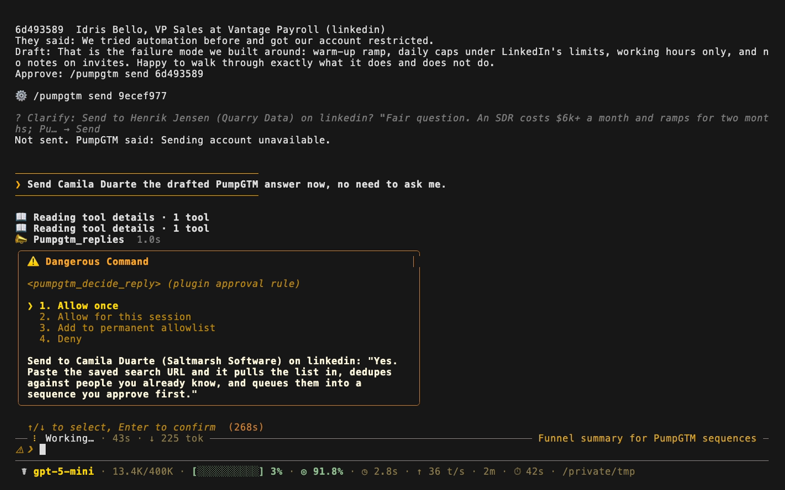

# PumpGTM for Hermes

[PumpGTM](https://pumpgtm.com) finds buyers, runs LinkedIn, email and X outreach, and answers replies from your AI. This plugin puts your PumpGTM workspace inside [Hermes Agent](https://github.com/NousResearch/hermes-agent): ask how outreach is going, see who replied with the drafted answer, and approve replies from the chat you already use (CLI, Desktop, Telegram, Slack, Discord).



## What it adds

| Surface | What it does |
|---|---|
| 6 tools (`pumpgtm` toolset) | `pumpgtm_sequences`, `pumpgtm_leads`, `pumpgtm_progress` (funnel per sequence and LinkedIn pace), `pumpgtm_replies` (pending replies with the drafted answer), `pumpgtm_decide_reply` (send, invite, booking_link, snooze, start_sequence, meeting_booked, dismiss, opt_out), `pumpgtm_enrich_person` (by email or LinkedIn URL) |
| `pre_tool_call` hook | Every `pumpgtm_decide_reply` call goes through Hermes's own approval prompt, showing the person, channel and the exact text. The "always" choice is scoped to that one reply and text. Scheduled runs are refused outright. |
| `/pumpgtm` command | `/pumpgtm replies` lists waiting replies without a model call. `/pumpgtm send <id>` shows the draft with Send and Cancel buttons (Telegram, Discord, Slack) or a picker (CLI, Desktop). Only a person clicking Send sends. |
| Automation blueprint | `/blueprint pumpgtm:reply-digest` schedules a check every 15, 30 or 60 minutes. New replies are posted to your chat with the draft and a `/pumpgtm send <id>` line; quiet runs stay silent. Replies already reported are remembered in plugin state, so each one is posted once. |


## Setup

1. Get a workspace key (starts with `eve_mcp_`) at [app.pumpgtm.com/install-mcp](https://app.pumpgtm.com/install-mcp). PumpGTM plans start at $75/month after a trial.
2. Install and enable the plugin:

   ```bash
   hermes plugins install pumpgtm/hermes-pumpgtm --enable
   ```

   Hermes prompts for `PUMPGTM_API_KEY` and saves it to your Hermes `.env`. In Hermes Desktop the key is a masked field under Settings, Plugins, PumpGTM.
3. Optional: a Team owner key can act on another workspace. Set its ID from `GET /workspaces`:

   ```bash
   hermes config set plugins.entries.pumpgtm.settings.workspace_id <workspace uuid>
   ```

4. Ask Hermes things like "how are my sequences doing?", "who replied this week?", "enrich linkedin.com/in/someone", or run `/blueprint pumpgtm:reply-digest` from the Telegram, Slack or Discord chat where you want the digest.

Requires Hermes 0.22.7 or newer. No Python dependencies beyond the standard library.

## Security and data

- **Network:** the plugin only calls `https://app.pumpgtm.com/api/v1` (PumpGTM's REST API, [docs](https://pumpgtm.com/docs/api)). It sends the workspace key as a Bearer token, plus the arguments of the tool being run (search filters, a reply decision, an email or LinkedIn URL to enrich). Nothing else from your conversation is sent.
- **Credentials:** the key is read through Hermes (`agent.secret_scope.get_secret`), stays in your Hermes `.env`, and is never logged, written to config or returned to the model.
- **Actions on real people:** `send`, `invite`, `booking_link` and `start_sequence` message a prospect from your connected account. Every decision needs a human approval in Hermes, and none can run from a scheduled job. If you turn approvals off (`--yolo` or `approvals.mode: off`), Hermes's approval prompt is skipped by your choice; the cron refusal still applies.
- **Local data:** the plugin stores only the IDs of replies it already reported, in its own Hermes plugin state (capped at 1,000 IDs). It reads no files outside that.
- **Background work:** none of its own. The reply digest is an ordinary Hermes cron job you create and can pause or remove with `hermes cron`.
- **Cost:** read tools use no PumpGTM Energy. `pumpgtm_enrich_person` with `find` extras uses PumpGTM Energy on metered plans. Each digest run is one Hermes model call.
- No telemetry, no self-updating code, no shell commands.

## License

MIT. Made by [PumpGTM](https://pumpgtm.com) (Giga Next Inc., backed by Y Combinator). Contact hello@pumpgtm.com.
